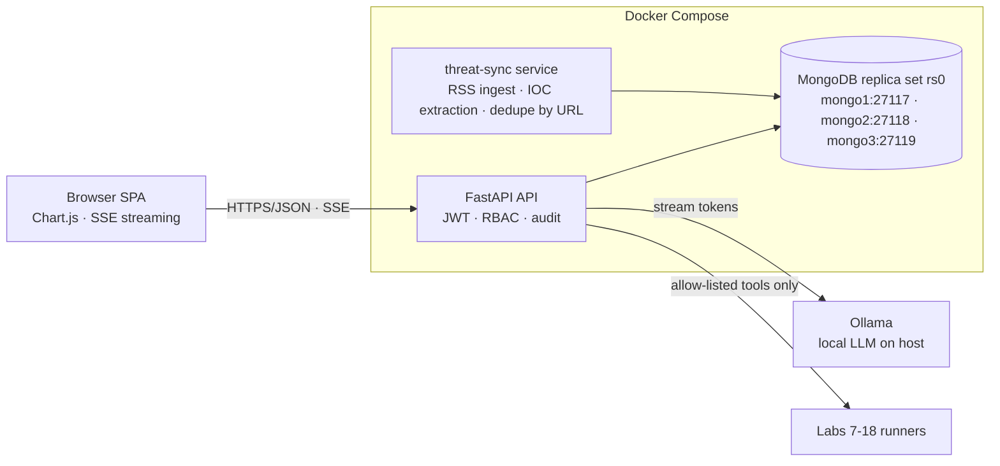

# SENTINEL-X Architecture

## Request path (assistant)
1. `POST /api/assistant/stream` (JWT required).
2. **Tier 1 – instant** (< ~50 ms, no model): built-in knowledge base, live read-only database tools, lab status/output, system health, security summary (admin).
3. **Tier 2 – cache**: repeated first-turn questions are answered from an in-memory TTL cache.
4. **Tier 3 – streaming LLM**: tokens are forwarded over Server-Sent Events as Ollama produces them; the model is kept warm (`keep_alive`) and pre-loaded at API startup.

## Security design
Argon2id hashing with transparent upgrade of legacy hashes · JWT with expiry, unique ID and server-side revocation on logout · roles read from the database on every request · per-username+IP lockout · full login audit (user ID, role, IP, user-agent, correlation ID, failure reason) · repeated-failure and password-spraying detection · CSV-injection-safe exports · tenant-scoped data access · assistant restricted to an allow-listed tool registry with explicit confirmation for destructive lab operations · no shell access · request-ID and security headers on every response.

## Data
`users`, `login_activity` (indexed), `revoked_tokens` (TTL), `threats` (deduplicated by canonical URL, labelled by `record_origin`), `sources`, `experiment_runs`, `assistant_history`, `tasks` (tenant-isolated).
